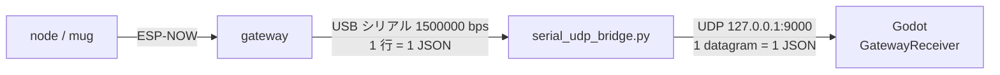

# Beer-fw

M5StickC Plus2 を使ったゲーム用の共通ファームウェア。
複数台の node で計測したセンサー値を ESP-NOW で受信機（gateway）に集め、USB シリアル経由で PC（Godot など）から使える。
ゲームごとの動作はゲーム専用モジュールとビルド環境で足す。

## 機能

- **センサー送信**: node（最大 8 台）の値を gateway が JSON 1 行ずつ USB シリアルへ出力
- **モジュール構成**: センサー・機能ごとにファイルを分け、`config.h` とビルド環境で有効/無効を切り替え
- **汎用モジュール**: 加速度、振動（Vibration Hat）、電池監視（残量 20 % 以下でフラグ送信、5 % 以下で警報振動）
- **省電力**: 送信時だけ無線を起動、画面の自動消灯、CPU 80 MHz、待ち時間の light sleep

## 収録ゲーム

| ゲーム | 環境 | 内容 |
| --- | --- | --- |
| ビールジョッキ | `mug` | ジョッキに入れた node が飲む動作（傾ける）を検出し、傾けている間振動する |

## 必要なもの

- M5StickC Plus2（node 1 台〜、gateway 1 台）
- M5StickC Vibration Hat（M5Stack U159）（振動を使う場合）
- [PlatformIO](https://platformio.org/)（VS Code 拡張または CLI）

## ビルド・書き込み

| 区分 | 環境 | 用途 |
| --- | --- | --- |
| 汎用 | `node` | 送信側。100 ms ごとに送信 |
| 汎用 | `node_lowpower` | 送信側の省電力版。送信時だけ無線を起動し、1 秒ごと＋状態変化時に送信 |
| 汎用 | `gateway` | 受信機。全ゲーム共通。受信データを JSON 1 行ずつ USB シリアルへ出力 |
| ゲーム別 | `mug` | ビールジョッキ（`node_lowpower` + 飲酒検出） |

```sh
pio run -e gateway -t upload                                   # 受信機
pio run -e node -t upload                                      # 汎用 node（NODE_ID=1）
PLATFORMIO_BUILD_FLAGS="-DNODE_ID=2" pio run -e node -t upload # 2 台目以降
pio run -e mug -t upload                                       # ビールジョッキ
pio device monitor -e gateway                                  # gateway のシリアル出力（1500000 bps）
pio device monitor -e mug                                      # node のシリアル出力（115200 bps）
```

node 側の送信先は `src/config.h` の `COMM_GATEWAY_MAC`。受信機の起動画面に出る AP MAC を設定する。

新しいゲームの足し方は [doc/system-architecture.md](doc/system-architecture.md) の「ビルド環境」を参照。

### MAC の確認（B ボタン）

B ボタン（右側面）を押すと、MAC 表示と通常表示が切り替わる。

| 機器 | B ボタンで出る内容 |
| --- | --- |
| node 系（`node` / `node_lowpower` / `mug`） | 自機の MAC（`GATEWAY_NODE_TABLE` に書く値）、`NODE_ID`、送信先の gateway MAC |
| gateway | AP MAC（node の `COMM_GATEWAY_MAC` に書く値）を大きく、チャンネル |

node は画面が自動で消えると通常表示に戻る。

gateway の通常画面には、上から gateway 自身の加速度、node ごとの飲酒判定（番号順、最大 5 行）、AP MAC が出る。

| 飲酒判定の行 | 意味 |
| --- | --- |
| `N1 PRESS A` | node 1 は検出前（node の A ボタンで開始） |
| `N1 ----  3deg #12` | 検出中・飲んでいない（傾き 3°、ゴクッ累計 12 回） |
| `N1 GOKU  52deg #12`（黄） | 飲んでいる |
| `N1 no data`（赤） | 3 秒以上届いていない |
| `N1 no drink` | node のファームに飲酒検出が入っていない |

### node 番号を MAC で固定する

`src/config.h` の `GATEWAY_NODE_TABLE` に MAC と番号を書いて gateway を書き込むと、JSON の `node` はその番号になる。node 側は全台 `NODE_ID` を変えずに同じファームを書き込めばよい。

```c
#define GATEWAY_NODE_TABLE \
    {"AA:BB:CC:DD:EE:01", 1}, \
    {"AA:BB:CC:DD:EE:02", 2},
```

- MAC はチップ固有で、再起動や書き直しでは変わらない。node の B ボタンで出る `My MAC`（起動時にも 2 秒出る）を使う。
- 表にない node は書き込み時の `NODE_ID` のまま出力する。gateway のログに `Add: {"AA:BB:CC:DD:EE:FF", 1},` と表に足す 1 行が出るので、それをコピーすればよい。
- 同じ MAC や同じ番号が表に 2 回あると、gateway の起動時に警告が出る。

## 使い方（ビールジョッキ）

1. ジョッキを机にまっすぐ置き、A ボタンを押す（姿勢の基準を記録して検出開始）
2. 飲む（傾ける）と振動する
3. A ボタン短押しで基準の取り直し、1 秒以上の長押しで停止

## 受信データ（Godot・PC 側向け）

gateway は node から 1 パケット受け取るごとに、USB シリアルへ JSON を 1 行出す。Godot では `tools/serial_udp_bridge.py` が UDP に中継したものを `godot/gateway_receiver.gd`（`GatewayReceiver`）で受け取る。手順は [doc/godot-connection-test.md](doc/godot-connection-test.md)。



### 受け取り方

```gdscript
func _ready() -> void:
	var rx := GatewayReceiver.new()
	rx.packet_received.connect(_on_packet)
	add_child(rx)

func _on_packet(node_id: int, data: Dictionary) -> void:
	var drink: Dictionary = data.get("drink", {})
	if drink.get("active", 0) == 1:
		pass   # node_id のジョッキで飲んでいる
```

- `data` は下の JSON をそのまま Dictionary にしたもの。
- Godot の JSON パーサーは数値をすべて `float` で返す。比較や配列の添字に使うときは `int()` で変換する。
- モジュールのキー（`accel` など）は、そのモジュールが無効なビルドでは出ない。`data.get("drink", {})` のように、無い場合に備えて読む。

### JSON の例

```json
{"node":1,"mac":"AA:BB:CC:DD:EE:FF","seq":42,"t":12345,"rx":43,"lost":0,
 "accel":{"x":0.0123,"y":-0.0456,"z":0.9989},
 "vibration":100,
 "drink":{"armed":1,"active":1,"tilt":52,"gulps":12},
 "battery":{"level":80,"low":0,"alarm":0}}
```

実際の出力は改行なしの 1 行。

### 共通項目

| キー | 型 | 内容 |
| --- | --- | --- |
| `node` | int | node の ID（1〜255）。`GATEWAY_NODE_TABLE` にある node はその番号、ない node は書き込み時の `NODE_ID`。プレイヤー番号などに使う。0 は gateway 自身の行（上記） |
| `mac` | string | node の MAC アドレス（`node` = 0 の行は gateway の AP MAC） |
| `seq` | int | 送信ごとに +1（0〜65535 で一周）。node が再起動すると 0 に戻る |
| `t` | int | node の起動からの経過時間 [ms]（`node` = 0 の行は gateway の起動から）。時刻の基準は機器ごとに違うので、node どうしや gateway と比べない |
| `rx` | int | gateway がその node から受け取った累計パケット数（`node` = 0 の行には無い。`lost` も同じ） |
| `lost` | int | 届かなかったパケットの累計数（`seq` の飛びから推定） |

### gateway 自身の加速度・角速度（`node` = 0）

gateway も自分の内蔵 IMU の加速度・角速度を、node の行と同じシリアルに 10 ms ごと（100 回/秒）に出す。`node` が 0 の行が gateway 自身。node の番号は 1〜255 なので重ならない。

```json
{"node":0,"mac":"00:4B:12:A2:4C:5D","seq":7,"t":12345,"accel":{"x":0.0012,"y":-0.0034,"z":1.0011},"gyro":{"x":-0.37,"y":0.06,"z":-0.12}}
```

- `mac` は gateway の AP MAC、`seq` は gateway の行ごとに +1、`t` は gateway の起動からの経過時間 [ms]。
- `accel` は node と同じ形式。`gyro` は gateway の行だけにある（node は送らない）。`rx` / `lost` とほかのモジュールのキーは出ない。
- `GatewayReceiver` は gateway の行を `gateway_received(data)` で通知する。`packet_received` / `node_connected` は node（1〜255）だけなので、gateway がプレイヤーとして増えることはない。

```gdscript
func _ready() -> void:
	var rx := GatewayReceiver.new()
	rx.packet_received.connect(_on_packet)     # node
	rx.gateway_received.connect(_on_gateway)   # gateway 自身
	add_child(rx)

func _on_gateway(data: Dictionary) -> void:
	var a: Dictionary = data.get("accel", {})   # gateway の傾き・揺れ
	var gx := float(data.get("gyro", {}).get("x", 0.0))   # x 軸まわりの角速度 [deg/s]
```

止めるときは `-DGATEWAY_ACCEL_ENABLE=0`、周期は `GATEWAY_ACCEL_PERIOD_MS`（`src/config.h`）で変える。

### センサー・機能ごとの項目

| キー | 型 | 内容 |
| --- | --- | --- |
| `accel.x` / `accel.y` / `accel.z` | float | 内蔵 IMU の加速度 [G]。静止時は合計で約 1.0（重力）。軸は M5StickC Plus2 本体の向き |
| `gyro.x` / `gyro.y` / `gyro.z` | float | gateway の行（`node` = 0）だけ。内蔵 IMU の角速度 [deg/s]（±2000）。補正なしの生の値で、Sensor Test App の gX/gY/gZ と同じ単位・向き |
| `vibration` | int | 今の振動の強さ（0〜100 [%]）。0 なら止まっている |
| `drink.armed` | 0 / 1 | 1 = 検出中（A ボタンで開始済み）。0 のときは他の `drink` の値を使わない |
| `drink.active` | 0 / 1 | 1 = 飲んでいる。40° 以上の傾きが 0.3 秒続くと 1、30° 未満に戻ると 0 |
| `drink.tilt` | int | 直立の基準からの傾き [deg]。方向は区別しない |
| `drink.gulps` | int | 「ゴクッ」の回数の累計（連続振動のときも同じ間隔で数える）。node の再起動で 0 に戻る |
| `battery.level` | int | 電池残量 [%]。取得できないときは負の値 |
| `battery.low` | 0 / 1 | 1 = 残量 20 % 以下。充電・交換の合図に使える（25 % まで戻ると 0） |
| `battery.alarm` | 0 / 1 | 1 = 残量 5 % 以下。node は電源が落ちるまで振動し続ける |

### 届く頻度

| node の環境 | 送信間隔 |
| --- | --- |
| `node` | 100 ms ごと（10 回/秒） |
| `mug` | 1 秒ごと |
| （gateway 自身、`node` = 0） | 10 ms ごと（100 回/秒）。node の有無に関係なく出る |

どちらの環境でも、飲み始め・飲み終わりや電池の警報など状態が変わったときは、間隔を待たずにすぐ送る。`mug` の `drink.tilt` や `accel` は 1 秒ごとにしか更新されないため、アニメーションを滑らかにしたいときは Godot 側で補間する。数秒（`mug` なら 3 秒程度）届かなければ、その node は切断・電源オフとみなしてよい。

## ドキュメント

- [doc/system-architecture.md](doc/system-architecture.md) — システム構成・ビルド環境・通信プロトコル・各機能の仕様
- [doc/gateway-accel.md](doc/gateway-accel.md) — gateway 自身の加速度・角速度（`node` = 0 の行）の仕様と設計判断
- [doc/fw-structure-proposal.md](doc/fw-structure-proposal.md) — ファイル構成の設計意図、モジュールの追加手順
