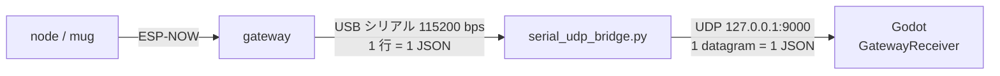

# Beer-fw

ビールジョッキに入れた M5StickC Plus2 が、飲む動作（ジョッキを傾ける）を検出して「ゴクゴク」と振動するファームウェア。
計測結果は ESP-NOW で受信機（gateway）に送り、USB シリアル経由で PC（Godot など）から使える。

## 機能

- **飲酒検出**: A ボタンで開始。基準姿勢から 40° 以上傾けて 0.3 秒続くと、ゴクッの振動を繰り返す（深く傾けるほど速い）
- **電池監視**: 残量 20 % 以下で gateway へフラグを送信、5 % 以下で電源が落ちるまで振動
- **省電力**: 送信時だけ無線を起動、画面の自動消灯、CPU 80 MHz、待ち時間の light sleep
- **モジュール構成**: センサー・機能ごとにファイルを分け、`config.h` で有効/無効を切り替え

## 必要なもの

- M5StickC Plus2（ジョッキ用 1 台〜、受信機用 1 台）
- M5StickC Vibration Hat（M5Stack U159）
- [PlatformIO](https://platformio.org/)（VS Code 拡張または CLI）

## ビルド・書き込み

| 環境 | 用途 |
| --- | --- |
| `mug` | ジョッキ用。省電力（送信時だけ無線を起動し、1 秒ごと＋状態変化時に送信） |
| `node` | 送信側の常時通信版（100 ms ごとに送信） |
| `gateway` | 受信機。受信データを JSON 1 行ずつ USB シリアルへ出力 |

```sh
pio run -e gateway -t upload                                   # 受信機
pio run -e mug -t upload                                       # ジョッキ（NODE_ID=1）
PLATFORMIO_BUILD_FLAGS="-DNODE_ID=2" pio run -e mug -t upload  # 2 台目以降
pio device monitor                                             # シリアル出力（115200 bps）
```

ジョッキ側の送信先は `src/config.h` の `COMM_GATEWAY_MAC`。受信機の起動画面に出る AP MAC を設定する。

## 使い方

1. ジョッキを机にまっすぐ置き、A ボタンを押す（姿勢の基準を記録して検出開始）
2. 飲む（傾ける）と振動する
3. A ボタン短押しで基準の取り直し、1 秒以上の長押しで停止

## 受信データ（Godot・PC 側向け）

gateway は node から 1 パケット受け取るごとに、USB シリアルへ JSON を 1 行出す。Godot では `tools/serial_udp_bridge.py` が UDP に中継したものを `godot/gateway_receiver.gd`（`GatewayReceiver`）で受け取る。手順は [doc/godot-connection-test.md](doc/godot-connection-test.md)。



### 受け取り方

```gdscript
func _ready() -> void:
	var rx := GatewayReceiver.new()
	rx.packet_received.connect(_on_packet)
	add_child(rx)

func _on_packet(node_id: int, data: Dictionary) -> void:
	var drink: Dictionary = data.get("drink", {})
	if drink.get("active", 0) == 1:
		pass   # node_id のジョッキで飲んでいる
```

- `data` は下の JSON をそのまま Dictionary にしたもの。
- Godot の JSON パーサーは数値をすべて `float` で返す。比較や配列の添字に使うときは `int()` で変換する。
- モジュールのキー（`accel` など）は、そのモジュールが無効なビルドでは出ない。`data.get("drink", {})` のように、無い場合に備えて読む。

### JSON の例

```json
{"node":1,"mac":"AA:BB:CC:DD:EE:FF","seq":42,"t":12345,"rx":43,"lost":0,
 "accel":{"x":0.0123,"y":-0.0456,"z":0.9989},
 "vibration":100,
 "drink":{"armed":1,"active":1,"tilt":52,"gulps":12},
 "battery":{"level":80,"low":0,"alarm":0}}
```

実際の出力は改行なしの 1 行。

### 共通項目

| キー | 型 | 内容 |
| --- | --- | --- |
| `node` | int | node の ID（1〜255）。書き込み時の `NODE_ID`。プレイヤー番号などに使う |
| `mac` | string | node の MAC アドレス |
| `seq` | int | 送信ごとに +1（0〜65535 で一周）。node が再起動すると 0 に戻る |
| `t` | int | node の起動からの経過時間 [ms] |
| `rx` | int | gateway がその node から受け取った累計パケット数 |
| `lost` | int | 届かなかったパケットの累計数（`seq` の飛びから推定） |

### センサー・機能ごとの項目

| キー | 型 | 内容 |
| --- | --- | --- |
| `accel.x` / `accel.y` / `accel.z` | float | 内蔵 IMU の加速度 [G]。静止時は合計で約 1.0（重力）。軸は M5StickC Plus2 本体の向き |
| `vibration` | int | 今の振動の強さ（0〜100 [%]）。0 なら止まっている |
| `drink.armed` | 0 / 1 | 1 = 検出中（A ボタンで開始済み）。0 のときは他の `drink` の値を使わない |
| `drink.active` | 0 / 1 | 1 = 飲んでいる。40° 以上の傾きが 0.3 秒続くと 1、30° 未満に戻ると 0 |
| `drink.tilt` | int | 直立の基準からの傾き [deg]。方向は区別しない |
| `drink.gulps` | int | 「ゴクッ」と振動した回数の累計。node の再起動で 0 に戻る |
| `battery.level` | int | 電池残量 [%]。取得できないときは負の値 |
| `battery.low` | 0 / 1 | 1 = 残量 20 % 以下。充電・交換の合図に使える（25 % まで戻ると 0） |
| `battery.alarm` | 0 / 1 | 1 = 残量 5 % 以下。node は電源が落ちるまで振動し続ける |

### 届く頻度

| node の環境 | 送信間隔 |
| --- | --- |
| `node` | 100 ms ごと（10 回/秒） |
| `mug` | 1 秒ごと |

どちらの環境でも、飲み始め・飲み終わりや電池の警報など状態が変わったときは、間隔を待たずにすぐ送る。`mug` の `drink.tilt` や `accel` は 1 秒ごとにしか更新されないため、アニメーションを滑らかにしたいときは Godot 側で補間する。数秒（`mug` なら 3 秒程度）届かなければ、その node は切断・電源オフとみなしてよい。

## ドキュメント

- [doc/system-architecture.md](doc/system-architecture.md) — システム構成・通信プロトコル・各機能の仕様
- [doc/fw-structure-proposal.md](doc/fw-structure-proposal.md) — ファイル構成の設計意図、モジュールの追加手順
