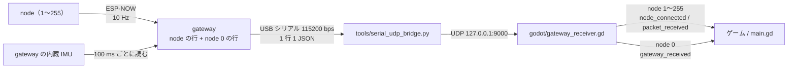
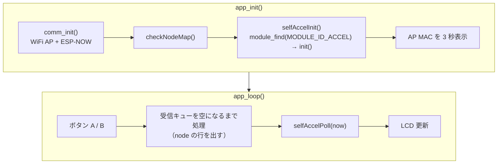

# gateway 自身の加速度出力

最終更新: 2026-10-19

## 何ができるようになったか

- gateway も自分の内蔵 IMU の加速度を、node のデータと同じ USB シリアルに 100 ms ごと（10 回/秒）に出す。
- 行の形式は node の行とほぼ同じで、`"node":0` が gateway 自身を表す（node は 1〜255 なので重ならない）。node が 1 台もいなくても出る。
- Godot 側は `GatewayReceiver` の `gateway_received` シグナルで受け取る。接続確認画面には「Gateway」カードとして出る。

## データの流れ



ブリッジは `{` で始まる行をそのまま UDP に中継するだけなので、node 0 の行のための変更はない（`--demo` の疑似データに gateway の行を足しただけ）。

## 出力される JSON

```json
{"node":0,"mac":"00:4B:12:A2:4C:5D","seq":7,"t":12345,"accel":{"x":0.0012,"y":-0.0034,"z":1.0011}}
```

| キー | 型 | 内容 |
| --- | --- | --- |
| `node` | int | 常に 0（`GATEWAY_SELF_NODE_ID`） |
| `mac` | string | gateway の AP MAC（node の `COMM_GATEWAY_MAC` に設定する値と同じ） |
| `seq` | int | gateway の行を出すたびに +1（0〜65535 で一周）。gateway の再起動で 0 に戻る |
| `t` | int | gateway の起動からの経過時間 [ms]（`millis()`） |
| `accel.x` / `.y` / `.z` | float | gateway 本体の加速度 [G]。形式は node の `accel` と同じ |

node の行との違い:

| 項目 | node の行 | gateway の行（node 0） |
| --- | --- | --- |
| `rx` / `lost` | あり | なし（無線を通らないので欠落がない） |
| `mac` | node の STA MAC | gateway の AP MAC |
| `t` | node の時刻 | gateway の時刻。node の `t` とは基準が違うので比較・差し引きできない |
| モジュールのキー | `accel`・`vibration`・`battery`・`drink` など | `accel` だけ |
| 出る契機 | node からパケットを受けたとき | gateway の周期（`GATEWAY_ACCEL_PERIOD_MS`）ごと |

`node_id` = 0 で送ってくる node（`GATEWAY_NODE_TABLE` にない場合）は、gateway の行と区別できないため、gateway が捨てる（node 表にも登録しない）。5 秒に 1 回まで `# [W] Node <MAC> sent node_id 0 (reserved for gateway), dropped. Add it to GATEWAY_NODE_TABLE` を出す。表に登録すれば、表の番号で出力される。この FW の `NODE_ID` は 1〜255 しか書き込めない（`config.h` でコンパイルエラー）ので、通常は起きない。

## Godot での受け取り方

`GatewayReceiver`（`godot/gateway_receiver.gd`）は `node` の値でシグナルを分ける。

| シグナル | 出る行 | 引数 |
| --- | --- | --- |
| `node_connected(node_id)` | node 1〜255 を初めて受信したとき | node 番号 |
| `packet_received(node_id, data)` | node 1〜255 の行ごと | node 番号、JSON そのまま |
| `gateway_received(data)` | node 0 の行ごと | JSON そのまま（`"accel"` など。`"rx"` / `"lost"` は無い） |

node 0 の行では `node_connected` / `packet_received` は出ない。そのため、node 用の処理（プレイヤー番号の割り当てなど）に gateway が紛れ込むことはない。番号 0 は定数 `GatewayReceiver.GATEWAY_NODE_ID` で参照できる。

```gdscript
func _ready() -> void:
	var rx := GatewayReceiver.new()
	rx.packet_received.connect(_on_packet)
	rx.gateway_received.connect(_on_gateway)
	add_child(rx)

func _on_packet(node_id: int, data: Dictionary) -> void:
	pass   # node 1〜255 のデータ。node_id をプレイヤー番号として使う

func _on_gateway(data: Dictionary) -> void:
	var a: Dictionary = data.get("accel", {})
	# gateway 本体の傾き・揺れ（例: 台を揺らす、机を叩く）
```

接続確認画面（`godot/main.gd`）は `gateway_received` を受けて node 0 のカードとして表示し、タイトルを「Gateway」にする。Gateway カードの受信情報は `seq` だけで、`rx` / `lost` は出さない。受信レート（`pkt/s`）と `packets` には gateway の行も数える。

## 設定

`src/config.h` の定数。前の 2 つは `build_flags` で上書きできる。

| 定数 | 既定値 | 内容 |
| --- | --- | --- |
| `GATEWAY_ACCEL_ENABLE` | 1 | 1 で gateway の行を出す。0 で出さない（コードごと外れる） |
| `GATEWAY_ACCEL_PERIOD_MS` | 100 | 出力周期 [ms]。node の既定送信周期（`COMM_TX_PERIOD_MS`）と同じ 10 Hz。10 未満はコンパイルエラー（シリアルが埋まるため） |
| `GATEWAY_SELF_NODE_ID` | 0 | gateway の行の `node`。上書き不可（Godot 側の `GATEWAY_NODE_ID` と揃えている） |

無効にするときは `platformio.ini` の `[env:gateway]` の `build_flags` に `-DGATEWAY_ACCEL_ENABLE=0` を足す。`GATEWAY_ACCEL_ENABLE=1` で `MODULE_ACCEL_ENABLE=0` にするとコンパイルエラーになる。

## FW の処理の流れ

実装は `src/app/gateway.cpp` の `selfAccelInit()` / `selfAccelPoll()`。



**初期化（`selfAccelInit`）**

- `module_find(MODULE_ID_ACCEL)` で加速度モジュールを探し、`init()`（`M5.Imu.isEnabled()`）だけを呼ぶ。
- 成功すれば `# [I] Gateway accel: node 0 every 100 ms` を出す。モジュールが無い・IMU が使えないときは `# [W] Gateway accel unavailable, node 0 disabled` を出し、以後 node 0 の行は出さない（node の受信はそのまま動く）。

**loop（`selfAccelPoll`）**

1. 前回から `GATEWAY_ACCEL_PERIOD_MS` 経っていなければ何もしない。
2. 加速度モジュールの `update()` で IMU を 1 回読む。
3. `accel_get()` が false（まだ一度も読めていない）なら出さない。
4. `encode()` で 12 バイト（float x, y, z）にし、`to_json()` で `"accel":{...}` にする。node の行を作るときと同じ関数なので、`accel` の形式は node と必ず一致する。
5. 先頭の `"node"`・`"mac"`・`"seq"`・`"t"` を付けて `Serial.println()` で 1 行出す。

node の受信処理を先に済ませてから呼ぶので、node の行の遅れは増えない。

**なぜ scheduler を回さないか**

gateway は node の受信データを JSON にするため、ゲーム専用を含む全モジュールを登録している（`MODULE_GAME_DEFAULT` = 1）。ここで `scheduler_init()` / `scheduler_run()` を回すと、全モジュールの `init()` / `update()` が動く。

| モジュール | gateway で動かすと起きること |
| --- | --- |
| vibration | Vibration Hat が無いのに振動ピン（GPIO 26）を PWM 駆動する |
| lowbat | 電池残量で振動警報を鳴らそうとする（gateway は USB 給電前提） |
| drink | gateway を傾けると飲酒検出・振動が動く |

必要なのは加速度だけなので、加速度モジュールの関数だけを直接呼ぶ。IMU を読むのは出力のときだけ（10 Hz）で、node のような 50 Hz（`ACCEL_PERIOD_MS`）の取得はしない。

## 設計判断

採用案: **gateway が加速度モジュールの init / update / encode / to_json だけを直接呼び、独立した `"node":0` の行を同じシリアルに出す。**

| 案 | 内容 | 帯域 | 受信側の変更 | 判断 |
| --- | --- | --- | --- | --- |
| 採用: node 0 の行 | gateway が 100 ms ごとに自分の行を出す | 約 105 B × 10 Hz（約 1 kB/s、帯域の約 9 %）。node の台数に依存しない | ブリッジ不要。Godot は `node` == 0 で分けるだけ | 採用 |
| A: node の行に埋め込む | node の行ごとに gateway の値を追加キーで付ける | 1 行 +約 45 B × 8 台 × 10 Hz ≒ +3.6 kB/s。すでに足りない帯域をさらに圧迫する | 少ない | 不採用。node が 0 台のときに出ない。サンプル時刻が node の受信時刻に引きずられてずれる |
| B: 別キーの行 | `{"gateway":{...}}` のように `node` を持たない行にする | 採用案と同じ | 必須。今の受信側は `has("node")` が無い行をエラーとして捨てる | 不採用 |

- node の行と同じ形式にしたことで、ブリッジは変更なし、Godot の受信側も `node` の値で分岐するだけで済んだ。
- 番号 0 を予約にした代わりに、`node_id` = 0 で来る node を gateway が捨てる（[出力される JSON](#出力される-json)）。

## 既知の課題・今後

- **シリアル帯域が足りない（今回のスコープ外）**: 115200 bps（8N1）で送れるのは約 11.5 kB/s。node の行は 1 行約 180 B（`node` 環境: `accel`・`vibration`・`battery`）なので、8 台 × 10 Hz で約 14.4 kB/s となり、gateway の行が無くても帯域を超える（約 1.25 倍）。gateway の行は約 105 B × 10 Hz ≒ 1 kB/s（約 9 %）を足す。
  - 対策候補はボーレートの引き上げ（例: 921600 bps）や `Serial.setTxBufferSize()` だが、USB シリアル変換や PC 側の動作を実機で確認する必要があるため別対応とする。
  - 今の台数・レートで詰まっていないかは、Godot の `lost` と gateway の `RX queue overflow` 警告で確認する。
- **gateway 用モジュールの汎用化は見送り**: 「gateway で動かすモジュール ID の一覧」を設定で持ち、それを回して node 0 の行を作る案もあるが、今は加速度だけなので直接呼ぶ形にとどめた。2 つ目（例: gateway のボタン）が必要になったら検討する。
- **時刻の対応**: node の `t` と gateway の `t` は比較できない。node と gateway の値を同じ時刻で揃えたいときは、Godot 側の受信時刻で扱う。

## 動作確認の方法

### 実機なし（`--demo`）

```sh
python3 tools/serial_udp_bridge.py --demo --nodes 3
```

Godot で `godot/project.godot` を実行すると、Gateway と Node 1〜3 のカードが並ぶ。Gateway カードは机に置いたままの値（x, y ≒ 0、z ≒ 1.0）でわずかに揺れ、受信情報は `seq` だけになる。

### 実機

1. gateway を書き込み、`pio device monitor` で起動ログを見る。

   ```
   # [I] Gateway accel: node 0 every 100 ms
   ```

   `Gateway accel unavailable` が出たら IMU が使えていない。

2. node が 0 台でも `{"node":0,...}` の行が約 10 行/秒で流れることを確認する。
3. モニターを閉じてブリッジを起動し（[godot-connection-test.md](godot-connection-test.md)）、Godot を実行する。gateway 本体を傾けると Gateway カードのバーと傾きの点が動く。node を傾けたときは Node カードだけが動く。
