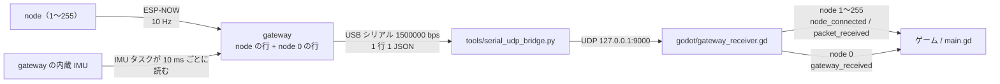
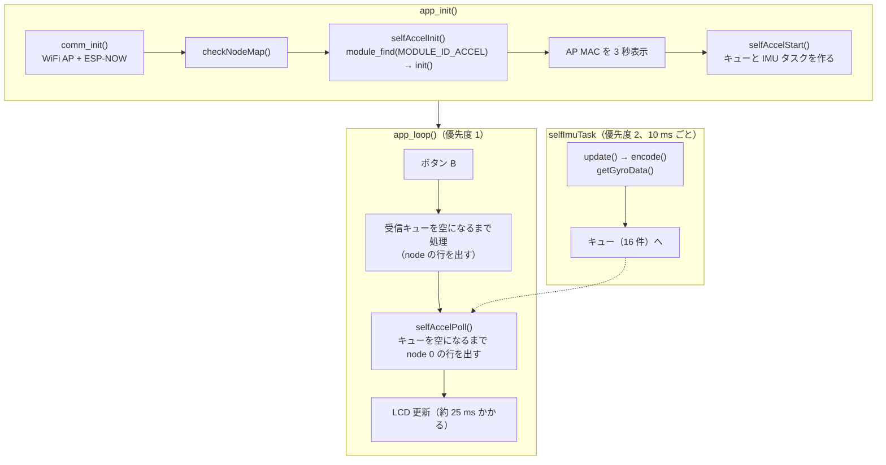

# gateway 自身の加速度・角速度出力

最終更新: 2026-10-26

## 何ができるようになったか

- gateway も自分の内蔵 IMU の加速度と角速度（ジャイロ）を、node のデータと同じ USB シリアルに 10 ms ごと（100 回/秒）に出す。
- 行の形式は node の行とほぼ同じで、`"node":0` が gateway 自身を表す（node は 1〜255 なので重ならない）。node が 1 台もいなくても出る。
- 角速度は Sensor Test App と同じ生の値 [deg/s] なので、Sensor Test App で測ったしきい値（例: `x_Jairo.json` の gX ≥ 365.7）をそのままゲーム側で使える。
- Godot 側は `GatewayReceiver` の `gateway_received` シグナルで受け取る。接続確認画面には「Gateway」カードとして出る。

## データの流れ



ブリッジは `{` で始まる行をそのまま UDP に中継するだけなので、node 0 の行のための変更はない。既定のボーレートだけ gateway に合わせて 1500000 にした（`--baud` で変えられる）。

## 出力される JSON

```json
{"node":0,"mac":"00:4B:12:A2:4C:5D","seq":7,"t":12345,"accel":{"x":0.0012,"y":-0.0034,"z":1.0011},"gyro":{"x":-0.37,"y":0.06,"z":-0.12}}
```

| キー | 型 | 内容 |
| --- | --- | --- |
| `node` | int | 常に 0（`GATEWAY_SELF_NODE_ID`） |
| `mac` | string | gateway の AP MAC（node の `COMM_GATEWAY_MAC` に設定する値と同じ） |
| `seq` | int | IMU を読むたびに +1（0〜65535 で一周）。gateway の再起動で 0 に戻る。キューがあふれて捨てた分は飛ぶ |
| `t` | int | IMU を読んだ時刻。gateway の起動からの経過時間 [ms]（`millis()`）。シリアルに出た時刻ではない |
| `accel.x` / `.y` / `.z` | float | gateway 本体の加速度 [G]。形式は node の `accel` と同じ |
| `gyro.x` / `.y` / `.z` | float | gateway 本体の角速度 [deg/s]（±2000、小数 2 桁）。M5Unified の生の値で、オフセット補正やフィルタはかけない |

`gyro` は Sensor Test App（`m5stick_sender`）の gX / gY / gZ と同じ値（同じ M5Unified の IMU 読み出し、同じ ±2000 dps 設定）で、軸の向きも同じ。静止時のずれ（ゼロ点）は個体ごとに違う。例: `x_Jairo.json` を測った個体は gX の平均が −1.89、今回テストした個体は約 0。しきい値が数百 deg/s なので、ゲームの判定には影響しない。

node の行との違い:

| 項目 | node の行 | gateway の行（node 0） |
| --- | --- | --- |
| `rx` / `lost` | あり | なし（無線を通らないので欠落がない） |
| `mac` | node の STA MAC | gateway の AP MAC |
| `t` | node の時刻 | gateway の時刻。node の `t` とは基準が違うので比較・差し引きできない |
| モジュールのキー | `accel`・`vibration`・`battery`・`drink` など | `accel` と `gyro` |
| 出る契機 | node からパケットを受けたとき | gateway の周期（`GATEWAY_ACCEL_PERIOD_MS`）ごと |
| 頻度 | `node` 10 Hz、`mug` 1 Hz | 100 Hz |

`node_id` = 0 で送ってくる node（`GATEWAY_NODE_TABLE` にない場合）は、gateway の行と区別できないため、gateway が捨てる（node 表にも登録しない）。5 秒に 1 回まで `# [W] Node <MAC> sent node_id 0 (reserved for gateway), dropped. Add it to GATEWAY_NODE_TABLE` を出す。表に登録すれば、表の番号で出力される。この FW の `NODE_ID` は 1〜255 しか書き込めない（`config.h` でコンパイルエラー）ので、通常は起きない。

## Godot での受け取り方

`GatewayReceiver`（`godot/gateway_receiver.gd`）は `node` の値でシグナルを分ける。

| シグナル | 出る行 | 引数 |
| --- | --- | --- |
| `node_connected(node_id)` | node 1〜255 を初めて受信したとき | node 番号 |
| `packet_received(node_id, data)` | node 1〜255 の行ごと | node 番号、JSON そのまま |
| `gateway_received(data)` | node 0 の行ごと（100 回/秒） | JSON そのまま（`"accel"`・`"gyro"`。`"rx"` / `"lost"` は無い） |

node 0 の行では `node_connected` / `packet_received` は出ない。そのため、node 用の処理（プレイヤー番号の割り当てなど）に gateway が紛れ込むことはない。番号 0 は定数 `GatewayReceiver.GATEWAY_NODE_ID` で参照できる。

```gdscript
func _ready() -> void:
	var rx := GatewayReceiver.new()
	rx.packet_received.connect(_on_packet)
	rx.gateway_received.connect(_on_gateway)
	add_child(rx)

func _on_packet(node_id: int, data: Dictionary) -> void:
	pass   # node 1〜255 のデータ。node_id をプレイヤー番号として使う

func _on_gateway(data: Dictionary) -> void:
	var a: Dictionary = data.get("accel", {})                # gateway 本体の傾き・揺れ [G]
	var gx := float(data.get("gyro", {}).get("x", 0.0))     # x 軸まわりの角速度 [deg/s]
```

1 フレームに数行（60 fps なら 1〜2 行）届くので、`gateway_received` はフレームごとではなく行ごとに処理する。しきい値判定は行ごとに行い、時間は `t`（10 ms 刻み）で数えると、フレームレートに左右されない。

### ジャイロのしきい値（`x_Jairo.json`）をゲームで使う

Sensor Test App で測ったプロファイル（gX、`positive`、しきい値 365.7、ヒステリシス 57.0、不応期 200 ms、測定時のサンプルレート 99 Hz）を node 0 の行に当てはめる例。測定時とほぼ同じ 100 Hz で届くので、ピークの取りこぼし方も測定時と同じになる。

```gdscript
const GX_THRESHOLD := 365.7
const GX_HYSTERESIS := 57.0
const GX_REFRACTORY_MS := 200

var _gx_armed := true
var _gx_last_fire_t := -100000

func _on_gateway(data: Dictionary) -> void:
	var gx := float(data.get("gyro", {}).get("x", 0.0))
	var t := int(data.get("t", 0))
	if _gx_armed and gx >= GX_THRESHOLD and t - _gx_last_fire_t >= GX_REFRACTORY_MS:
		_gx_armed = false
		_gx_last_fire_t = t
		# ここで「動作した」とみなす
	elif not _gx_armed and gx <= GX_THRESHOLD - GX_HYSTERESIS:
		_gx_armed = true
```

`t` は gateway の再起動で 0 に戻るので、途絶・再接続のあとは `_gx_last_fire_t` を戻す。

接続確認画面（`godot/main.gd`）は `gateway_received` を受けて node 0 のカードとして表示し、タイトルを「Gateway」にする。Gateway カードには `gyro x / y / z [dps]` の行も出る。受信情報は `seq` だけで、`rx` / `lost` は出さない。受信レート（`pkt/s`）と `packets` には gateway の行も数える（gateway だけなら約 100 pkt/s）。

### beer-rhythm（ゲーム本体）への影響

beer-rhythm の `app/input` は gateway の行を検査してから使う。今回の変更でそのまま通ることを実機の出力で確認した（下の [動作確認](#動作確認の方法)）。

- `gyro` キーは検査対象外なので、追加しても弾かれない。`accel` は今までどおり毎行に入れている（無いと `missing_accel` で捨てられる）。
- `AccelImpactDetector`（乾杯の検出）は「前回サンプルとの加速度の差」で判定していて、コメントに「gateway の加速度は 100 ms ごとにしか届かない」前提が書かれている。届く間隔が 10 ms になると、ゆっくりした動きの差は小さくなり、ぶつけた瞬間の鋭い変化だけが残る。しきい値 0.6 G と不応期 0.25 s が今のままで良いかは、ゲーム側で実機確認が必要。
- ブリッジは Beer-fw の `tools/serial_udp_bridge.py` を使うので、新しいブリッジ（既定 1500000 bps）を取得する。古いブリッジを使うときは `--baud 1500000` を付ける。

## 設定

`src/config.h` の定数。最初の 2 つは `build_flags` で上書きできる。

| 定数 | 既定値 | 内容 |
| --- | --- | --- |
| `GATEWAY_ACCEL_ENABLE` | 1 | 1 で gateway の行を出す。0 で出さない（コードごと外れる） |
| `GATEWAY_ACCEL_PERIOD_MS` | 10 | IMU を読んで行を出す周期 [ms]。ゲームのジャイロしきい値を測ったときと同じ約 100 Hz。10 未満はコンパイルエラー（シリアルが埋まるため） |
| `GATEWAY_SELF_NODE_ID` | 0 | gateway の行の `node`。上書き不可（Godot 側の `GATEWAY_NODE_ID` と揃えている） |
| `COMM_SERIAL_BAUD` | 1500000（gateway）/ 115200（node） | シリアルのボーレート。`build_flags` で上書きできる。`platformio.ini` の `[env:gateway]` の `monitor_speed` とブリッジの既定値も 1500000 |

無効にするときは `platformio.ini` の `[env:gateway]` の `build_flags` に `-DGATEWAY_ACCEL_ENABLE=0` を足す。`GATEWAY_ACCEL_ENABLE=1` で `MODULE_ACCEL_ENABLE=0` にするとコンパイルエラーになる。

## FW の処理の流れ

実装は `src/app/gateway.cpp` の `selfAccelInit()` / `selfImuTask()` / `selfAccelStart()` / `selfAccelPoll()`。



**初期化（`selfAccelInit` / `selfAccelStart`）**

- `module_find(MODULE_ID_ACCEL)` で加速度モジュールを探し、`init()`（`M5.Imu.isEnabled()`）だけを呼ぶ。
- 成功すれば `# [I] Gateway accel: node 0 every 10 ms` を出す。モジュールが無い・IMU が使えないときは `# [W] Gateway accel unavailable, node 0 disabled` を出し、以後 node 0 の行は出さない（node の受信はそのまま動く）。
- AP MAC の 3 秒表示が終わってから IMU タスクを起動する。先に起動すると、待っている間にキューがあふれる。

**IMU タスク（`selfImuTask`）**

1. `vTaskDelayUntil` で 10 ms ごとに起きる（遅れても周期がずれない）。
2. 加速度モジュールの `update()` で IMU を 1 回読み、`encode()` で 12 バイト（float x, y, z）にする。
3. `M5.Imu.getGyroData()` で角速度を取る。M5Unified は直前の読み出しから 256 µs 以内なら IMU を読み直さないので、加速度と同じサンプルになる。
4. 時刻（`millis()`）と `seq` を付けてキューに積む。キューが満杯なら捨てて数える。

IMU（I2C）に触るのはこのタスクだけ。M5StickC Plus2 では `M5.update()`（ボタン）も電池残量（ADC）も I2C を使わない。

**loop（`selfAccelPoll`）**

1. キューを空になるまで取り出す。
2. `to_json()` で `"accel":{...}` にし、`"gyro":{...}` を足し、先頭に `"node"`・`"mac"`・`"seq"`・`"t"` を付けて `Serial.println()` で 1 行ずつ出す。`accel` は node の行を作るときと同じ関数なので、形式は node と必ず一致する。
3. 捨てたサンプルがあれば `# [W] Gateway accel queue overflow: <n> samples dropped in total` を出す。

**なぜタスクにしたか**

最初は loop の中で 10 ms ごとに読んでいたが、実機で測ると 76.7 Hz しか出ず、100 ms ごとに 34〜35 ms の空きがあった。LCD の描き直し（`display_begin()` の全面塗りつぶしと文字描画。CPU 80 MHz で約 25 ms）の間は loop が止まり、その間の 2 サンプルを取り逃していた。腕を振ったときのジャイロのピークは数十 ms しか続かないので、この空きでピークを取りこぼす。IMU を loop より優先度の高いタスクで読めば、描画中も周期どおりに読める。出力は描画が終わってからまとめて出るので、最大で約 25 ms 遅れる。

**なぜ scheduler を回さないか**

gateway は node の受信データを JSON にするため、ゲーム専用を含む全モジュールを登録している（`MODULE_GAME_DEFAULT` = 1）。ここで `scheduler_init()` / `scheduler_run()` を回すと、全モジュールの `init()` / `update()` が動く。

| モジュール | gateway で動かすと起きること |
| --- | --- |
| vibration | Vibration Hat が無いのに振動ピン（GPIO 26）を PWM 駆動する |
| lowbat | 電池残量で振動警報を鳴らそうとする（gateway は USB 給電前提） |
| drink | gateway を傾けると飲酒検出・振動が動く |

必要なのは加速度と角速度だけなので、加速度モジュールの関数と `M5.Imu.getGyroData()` だけを直接呼ぶ。

## 設計判断

**node 0 の行にする**（2026-10-19）

採用案: **gateway が加速度モジュールの init / update / encode / to_json だけを直接呼び、独立した `"node":0` の行を同じシリアルに出す。**

| 案 | 内容 | 受信側の変更 | 判断 |
| --- | --- | --- | --- |
| 採用: node 0 の行 | gateway が周期ごとに自分の行を出す | ブリッジ不要。Godot は `node` == 0 で分けるだけ | 採用 |
| A: node の行に埋め込む | node の行ごとに gateway の値を追加キーで付ける | 少ない | 不採用。node が 0 台のときに出ない。サンプル時刻が node の受信時刻に引きずられる。帯域を台数分使う |
| B: 別キーの行 | `{"gateway":{...}}` のように `node` を持たない行にする | 必須。受信側は `has("node")` が無い行をエラーとして捨てる | 不採用 |

**ジャイロを足し、100 Hz にする**（2026-10-26）

| 決めたこと | 理由 | 見送った案 |
| --- | --- | --- |
| `gyro` を node 0 の行に足す（x / y / z すべて） | ゲームのしきい値は gX。y / z も 1 行 +約 25 バイトで出せるので、軸を変えたくなったときに FW を書き換えなくて済む | x だけ出す（帯域は少し減るが、1500000 bps なら余裕がある） |
| 10 ms ごと（100 Hz） | しきい値を測った Sensor Test App が 99 Hz。10 Hz ではピークの間を読んでしまい、測定値より低く見える | 100 Hz で読んで 10 Hz で最大値を出す（遅延が最大 100 ms 増える。リズムゲームの入力には遅い） |
| ボーレート 1500000（gateway だけ） | 1 行約 142 バイト × 100 Hz ≒ 14 kB/s で、115200 bps（≒ 11.5 kB/s）では足りない。1500000 は esptool の書き込みと同じ速度で、FTDI・CH9102 のどちらでも読めた | 230400・460800・921600: macOS 標準ドライバで化けた（下記） |
| `accel` は毎行に残す | beer-rhythm が gateway の行に `accel` を必須にしている | — |

ボーレートを実機で比べた結果（Mac、macOS 標準ドライバ、ポート名 `cu.usbserial-*`）:

| gateway の出力 | CH9102（1A86:55D4、テストに借りたジョッキの個体） | FTDI FT232R（0403:6001、本番の gateway `00:4B:12:A2:4C:5D`） |
| --- | --- | --- |
| 230400 | 未確認 | 化ける |
| 460800 | 読める | 化ける |
| 921600 | 化ける | 未確認 |
| 1500000 | 読める | 読める（20 秒で 1561 行、すべて正常） |

化けるときは、PC 側の設定値を前後に変えても受信内容がまったく変わらなかった（例: FTDI で 400,000〜500,000）。ドライバがその速度を正しく設定できていないと判断した。ESP32 側の分周比（80 MHz ÷ ボーレート）はどの値でも誤差 0.1 % 未満。1500000 は esptool の書き込み速度と同じで、どちらのチップでも動作の実績がある。Windows では未確認。

## 既知の課題・今後

- **乾杯の検出（ゲーム側）の調整**: [beer-rhythm（ゲーム本体）への影響](#beer-rhythmゲーム本体への影響) のとおり、加速度の差で判定している `AccelImpactDetector` は 10 Hz 前提。100 Hz でのしきい値の見直しはゲーム側で行う。
- **シリアル帯域**: 1500000 bps ≒ 150 kB/s に対し、gateway の行が約 14 kB/s、`node` 環境の node 8 台 × 10 Hz（1 行約 180 バイト）で約 14.4 kB/s、合わせて約 19 %。`mug` は 1 Hz なので無視できる。
- **Windows での確認**: ゲームを Windows で動かすときは、ブリッジで `転送 100.0 行/s` が出て JSON の読めない行（Godot 側の `errors`）が増えないことを最初に確認する。
- **ポートを開くと gateway がリセットされる**: Mac で今回使った USB シリアル（CH9102、macOS 標準ドライバ）では、ブリッジがポートを開くたびに ESP32 が再起動した（ブリッジは DTR / RTS を下げてから開いているが効かない）。起動から約 3.5 秒（AP MAC の表示 3 秒を含む）は行が出ない。再起動直後の ROM の起動メッセージは 115200 bps で出るので、ブリッジの画面には文字化けした 1 行が出るが、`{` で始まらないので転送されない。
- **gateway 用モジュールの汎用化は見送り**: 「gateway で動かすモジュール ID の一覧」を設定で持ち、それを回して node 0 の行を作る案もあるが、今は加速度と角速度だけなので直接呼ぶ形にとどめた。2 つ目のモジュール（例: gateway のボタン）が必要になったら検討する。
- **時刻の対応**: node の `t` と gateway の `t` は比較できない。node と gateway の値を同じ時刻で揃えたいときは、Godot 側の受信時刻で扱う。

## 動作確認の方法

### 実機なし（`--demo`）

```sh
python3 tools/serial_udp_bridge.py --demo --nodes 3
```

Godot で `godot/project.godot` を実行すると、Gateway と Node 1〜3 のカードが並ぶ。Gateway カードは机に置いたままの値（x, y ≒ 0、z ≒ 1.0、gyro ≒ ±2）でわずかに揺れ、受信情報は `seq` だけになる。デモの gateway の行も 100 Hz で出る。

### 実機

1. gateway を書き込み、`pio device monitor -e gateway`（1500000 bps）で起動ログを見る。

   ```
   # [I] Gateway accel: node 0 every 10 ms
   # [I] Gateway ready.
   ```

   `Gateway accel unavailable` が出たら IMU が使えていない。

2. node が 0 台でも `{"node":0,...,"gyro":{...}}` の行が約 100 行/秒で流れることを確認する。
3. モニターを閉じてブリッジを起動し（[godot-connection-test.md](godot-connection-test.md)）、ブリッジの `転送 100.0 行/s` を確認する。Godot を実行し、gateway を x 軸まわりに素早くひねると Gateway カードの `gyro x` が数百まで上がる。

### 実機テストの結果（2026-10-26）

M5StickC Plus2 1 台に gateway を書き込み、机に置いたまま USB（CH9102、macOS 標準ドライバ）で読んだ。

| 項目 | 結果 |
| --- | --- |
| 出力レート（gateway の `t` で計算） | 100.0 Hz。間隔は 1590 回中 1589 回が 10 ms、1 回が 9 ms。`seq` の飛び 0、キューあふれの警告なし |
| ブリッジ経由 | `転送 100.0 行/s`、UDP で 100.0 pkt/s、`seq` の飛び 0 |
| JSON | 1591 行すべて JSON として読めた。beer-rhythm の `SensorPacketStream.validate()` と同じ検査で弾かれる行 0 |
| 1 行の長さ | 平均 140、最大 142 バイト（約 11〜14 kB/s） |
| 静止時の gyro | x: 平均 0.08、標準偏差 0.25（−0.55〜0.73）。y・z も ±0.2 以内 |
| `x_Jairo.json` の判定（gX ≥ 365.7） | 静止中の誤検出 0 回 |
| 参考: loop で読んでいた版 | 76.7 Hz。100 ms ごとに 34〜35 ms の空き（LCD の描き直し中） |

このときは 460800 bps。本番の gateway（FTDI）では 460800 が化けたため、1500000 bps に変えて本番の gateway でもう一度確認した（2026-10-27）。ジョッキ（node 1、`mug`）を電源オンにして、node の行が混ざる状態で読んだ。

| 項目 | 結果 |
| --- | --- |
| 出力レート | 100.0 Hz。間隔は 1560 回すべて 10 ms。`seq` の飛び 0 |
| ブリッジ経由（既定の 1500000 bps） | `転送 101.0 行/s`（gateway 100 + ジョッキ 1）。UDP で node 0 が 100.6 pkt/s、`seq` の飛び 0 |
| JSON | gateway の行 1561 行・ジョッキの行 19 行がすべて読めた。beer-rhythm と同じ検査で弾かれる行 0 |
| 静止時の gyro | x: 平均 0.02、標準偏差 0.31（−0.98〜1.16） |
| `x_Jairo.json` の判定（gX ≥ 365.7） | 静止中の誤検出 0 回 |

確認したのは机に置いたままの状態だけで、手に持って振ったときにしきい値を超えて検出されるかは未確認。
