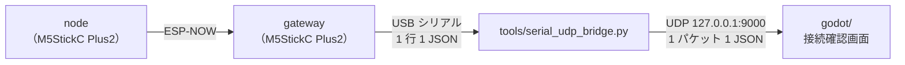

# Godot 接続確認プロジェクト

最終更新: 2026-10-07

gateway の出力が Godot まで届くかを確かめるための最小構成。ゲームを作る前に、配線・書き込み・PC 側の受け口を一通り確認する。

## 構成



Godot 4 には標準のシリアル API がないため、PC 上のブリッジがシリアルの JSON 行だけを UDP に中継する（[system-architecture.md](system-architecture.md) の「Godot 連携方式」の「USB シリアル + PC ブリッジ」）。gateway の FW は変更しない。

| ファイル | 役割 |
| --- | --- |
| `tools/serial_udp_bridge.py` | シリアル → UDP の中継。`{` で始まる行だけを送り、`#` 始まりのログはコンソールに出す。`--demo` で実機なしの疑似データを送る |
| `godot/gateway_receiver.gd` | `GatewayReceiver` ノード。UDP を受けて JSON を読み、node の行は `packet_received(node_id, data)`、gateway 自身の行（`node` = 0）は `gateway_received(data)` で出す。ゲームでもそのまま使える |
| `godot/main.gd` / `main.tscn` | 接続確認画面。node ごとに seq・欠落数・加速度・傾き・電池・振動・飲酒検出を表示する |

## 必要なもの

- Godot 4.7（4.x なら動く想定。確認は 4.7.2）
- pyserial 入りの Python 3。PlatformIO の Python（`~/.platformio/penv/bin/python`）に入っているので、それを使えば追加インストール不要

## 手順

### 1. 実機なしで Godot 側だけ確認する

```sh
python3 tools/serial_udp_bridge.py --demo --nodes 3
```

Godot で `godot/project.godot` を開いて実行（F5）。Gateway と Node 1〜3 のカードが並び、傾きの点が動けば Godot 側は正常（Gateway のカードは gateway 自身の加速度で、デモでは机に置いたままの値）。

### 2. 実機で確認する

1. gateway と node を書き込む（[README](../README.md)）。node の `COMM_GATEWAY_MAC` が gateway の AP MAC と合っていること。
2. gateway を USB で PC につなぐ。`pio device monitor` は閉じておく（ポートを取り合うため）。
3. ブリッジを起動する。

   ```sh
   ~/.platformio/penv/bin/python tools/serial_udp_bridge.py
   ```

   USB シリアルを自動で探す。見つからないときや複数あるときは `--port /dev/cu.usbserial-XXXX` で指定する。`-v` を付けると転送した JSON も表示する。

4. Godot で実行する。node を傾けるとそのカードの値が動く。gateway 本体を傾けると Gateway のカード（`node` = 0）が動く。

## 画面の見方

| 表示 | 正常 | 異常のときに疑うところ |
| --- | --- | --- |
| 上部のステータス | 緑。`pkt/s` が node 台数 × 送信レート（`node` は 10/s、`node_lowpower`・`mug` は 1/s ＋状態変化時）＋ gateway 自身の 10/s | 黄色「Listening…」: ブリッジ未起動、またはブリッジにデータが来ていない。赤: UDP ポートを他のアプリが使用中 |
| Node カードのタイトル | 緑 | 赤「(no data)」: その node から 1 秒以上届いていない。電源、`COMM_GATEWAY_MAC`、距離を確認 |
| Gateway カード | 緑。gateway を傾けると動く | Gateway だけ出て Node が出ない: シリアルとブリッジは正常で、node 側（電源・`COMM_GATEWAY_MAC`・距離）の問題。Gateway が「(no data)」: gateway の IMU 初期化失敗（ログに `Gateway accel unavailable`）か `GATEWAY_ACCEL_ENABLE=0` |
| `lost` | 0 のまま、たまに増える程度 | 増え続ける: 電波が弱い、または送信レートに対してシリアルが詰まっている |
| `errors` | 0 | 増える: JSON として読めない行が来ている。ボーレート（115200）を確認 |

`mug` 環境の node は 1 秒ごとに送るため、表示の更新も 1 秒ごとになる。

## ゲームで使うとき

`GatewayReceiver` をシーンに追加し、シグナルを受ける。

```gdscript
func _ready() -> void:
	var rx := GatewayReceiver.new()
	rx.packet_received.connect(_on_packet)
	add_child(rx)

func _on_packet(node_id: int, data: Dictionary) -> void:
	var a: Dictionary = data.get("accel", {})
	# node_id をプレイヤー番号として使う
```

`data` は gateway の JSON そのまま。キーは [system-architecture.md](system-architecture.md) の「シリアル出力」を参照。

## 未決事項

- [ ] ゲーム用のプロジェクトをこのリポジトリの `godot/` に置くか、別リポジトリにするか
- [ ] ブリッジを使い続けるか、GDExtension でシリアルを直接読むか（ブリッジは別プロセスの起動が必要）
